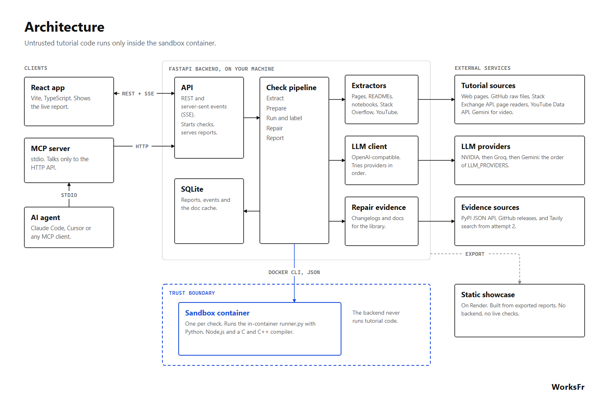
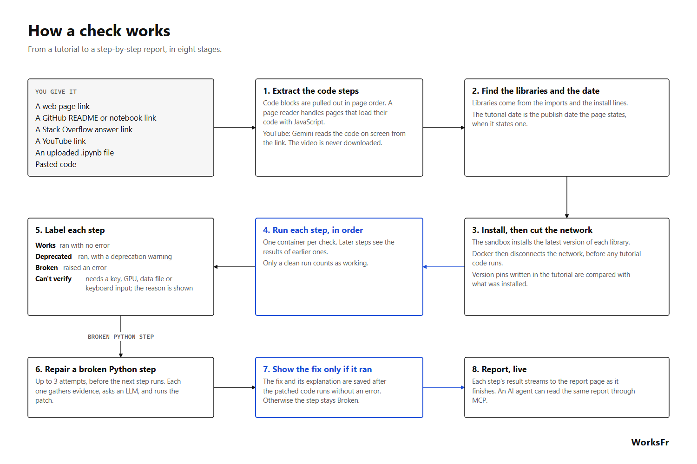
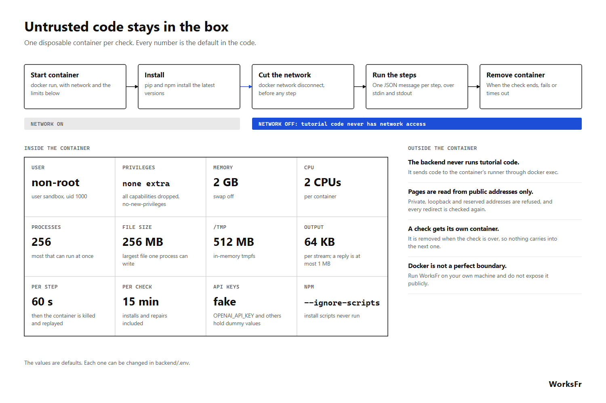
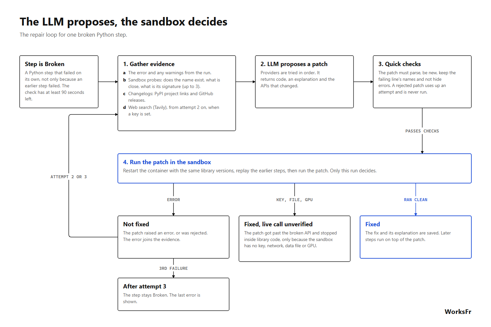

# Architecture

## Overview

WorksFr checks whether a tutorial's code still runs with today's library versions. You give it a URL, a pasted snippet, a Jupyter notebook or a YouTube link. It pulls out the code blocks, runs them in order inside a Docker container, labels each step, and tries to repair the broken Python ones. The backend is FastAPI with a SQLite database. A React frontend and an MCP server both talk to the backend's HTTP API. I treat tutorial code as hostile, so it only ever runs in the sandbox container, never in the backend process.

## A check, end to end

`pipeline.py` (`run_check`) runs one check in a worker thread. The pool size is `MAX_CONCURRENT_CHECKS`, default 1. The stages are:

1. Extract. `extract/routing.py` picks a reader for the source. `html_page.py`, `markdown_doc.py`, `notebook.py`, `paste.py`, `stackexchange.py` and `video.py` turn it into code blocks, the package list and the publish date the page states. If the page states none, the date is unknown. A page with no runnable code, or a notebook over `MAX_STEPS` (150) runnable cells, fails here with a plain message.
2. Prepare. `session.py` starts the sandbox, which installs the packages and reports the versions it got. `pins.py` compares those against any `pip install` pins in the tutorial.
3. Run and label. For each step, `labels.py` first applies cheap pre-run checks, then the step runs in the container. The result becomes one of four labels: works, deprecated, broken or cant_verify. A step that needs an API key, a GPU, a big download or keyboard input is labeled cant_verify with the reason. A step that fails only because an earlier step failed is marked as a cascade and is not repaired.
4. Repair. Broken Python steps go to `repair/loop.py`.
5. Report. `score.py` summarizes the steps and `recorder.py` stores the result.

Every stage emits an event (extracted, environment, step_started, step_result, repair_attempt, step_final, done or failed). `recorder.py` writes each event to SQLite first and then hands it to `broker.py`, so a client that connects late or drops its connection can replay the history. `GET /api/checks/{id}/events` streams those events as server-sent events and honors `Last-Event-ID`. The stream closes after `done` or `failed`.

## The sandbox

Each check gets one fresh container from the `worksfr-sandbox` image (`sandbox/Dockerfile`: Python 3.12, Node, tsx, gcc and g++). Steps share state, so one long-lived container with one namespace is simpler than a container per step. `backend/app/sandbox/docker_sandbox.py` drives it through the `docker` CLI with `subprocess`, always as an argument list.

Startup goes in this order. `docker run -d` starts the container with `sleep infinity` while it still has network. `pip install --upgrade` (and `npm install --ignore-scripts` for JavaScript) installs the tutorial's packages. `docker network disconnect` then cuts the network. Last, `docker exec -i ... python -u /opt/worksfr/runner.py` starts `sandbox/runner.py`, which reads one JSON request per line and writes one JSON reply per line. Operations are `exec` (run code in Python, JavaScript, TypeScript, C or C++) and `probe` (inspect a module or name). The runner keeps replies on a private copy of file descriptor 1, so tutorial output cannot corrupt the protocol.

The limits, from `backend/app/config.py`, each overridable through the environment:

| Setting | Default |
| --- | --- |
| `STEP_TIMEOUT_SECONDS` | 60 |
| `CHECK_TIMEOUT_SECONDS` | 900 |
| `SANDBOX_MEMORY` (swap capped to the same) | 2g |
| `SANDBOX_CPUS` | 2.0 |
| `SANDBOX_PIDS_LIMIT` | 256 |
| `SANDBOX_TMPFS_MB` (`/tmp`) | 512 |
| `SANDBOX_FILE_SIZE_MB` (per-file ulimit) | 256 |

The container also runs as the non-root `sandbox` user with `--cap-drop ALL` and `no-new-privileges`. A step that exceeds its timeout kills the container, and the session restarts it and replays the earlier steps.

## The repair loop

Only broken Python steps are repaired. JavaScript, TypeScript, C and C++ steps are run and labeled but not patched.

`repair/evidence.py` gathers evidence in a fixed order: the error and the warnings, sandbox probes of the failing API, changelogs from PyPI metadata and GitHub releases, and a Tavily search limited to the library's docs domain. The search starts at attempt 2 and is skipped without a `TAVILY_API_KEY`.

For each attempt (at most 3) the model proposes a patch, and `repair/loop.py` rejects it before running if it has invalid syntax, is empty, repeats an earlier attempt, hides errors behind a broad `except` that does nothing, drops every function call, or drops the names on the failing line. An accepted patch runs on a clean baseline: the sandbox restarts with the same pinned package versions, replays the earlier steps, then runs the patch. The verdict comes from `labels.judge_patch`:

- fixed: the patch ran with no error.
- fixed_unverified: it got past the broken API and stopped inside library code only because the sandbox has no key, network, data file or GPU.
- failed: anything else. After the last attempt the session resets to the last good state.

Repair is skipped when fewer than 90 seconds of the check budget remain (`REPAIR_MIN_SECONDS_LEFT`), and stops early if every LLM provider is unavailable.

## LLM providers

All model calls use the `openai` package against OpenAI-compatible endpoints. A provider is a block in `backend/.env`: `LLM_<NAME>_BASE_URL`, `LLM_<NAME>_API_KEY` and `LLM_<NAME>_MODEL`. `LLM_PROVIDERS` lists the names in the order to try them. A provider missing a field is skipped with a logged warning, and no provider names or URLs appear in the code. The model only proposes patches and writes explanations. A step counts as fixed only because the patched code ran in the sandbox.

## Storage and API

`storage.py` creates four SQLite tables: `checks`, `steps`, `events` and `doc_cache` (cached changelog and search results). The routes in `api.py` all sit under `/api`:

- `POST /checks` (URL), `POST /checks/code` (pasted code) and `POST /checks/notebook` (an `.ipynb` upload, 10 MB by default)
- `GET /checks` (recent checks) and `GET /checks/{id}` (the report)
- `GET /checks/{id}/events` (SSE) and `GET /checks/{id}/events/log` (stored events as JSON)
- `GET /api/health`

`mcp_server.py` is a stdio MCP server with four tools: `check_tutorial`, `check_code`, `get_report` and `recent_checks`. It only calls the HTTP API and polls for the result. It has no Docker access and never runs code.

## Key decisions

- ADR-001: only a sandbox run decides that a step works. A patch and its explanation are saved only after the patched code ran.
- ADR-002: one container per check, with the network disconnected before any tutorial code runs.
- ADR-003: the runner speaks JSON lines over stdin and a private copy of stdout.
- ADR-007: Docker is driven through the CLI, not the Python SDK, because a two-way pipe to the runner is unreliable over the Windows named pipe.
- ADR-009: LLM providers are configuration in `.env`, not code.
- ADR-010: the report describes each step and never grades the tutorial.
