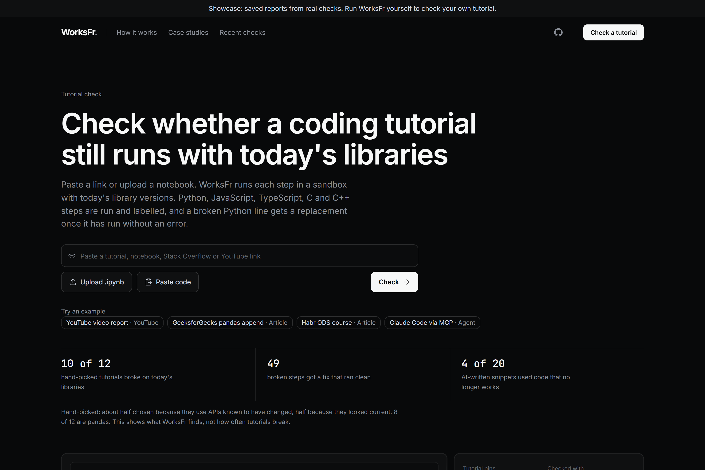
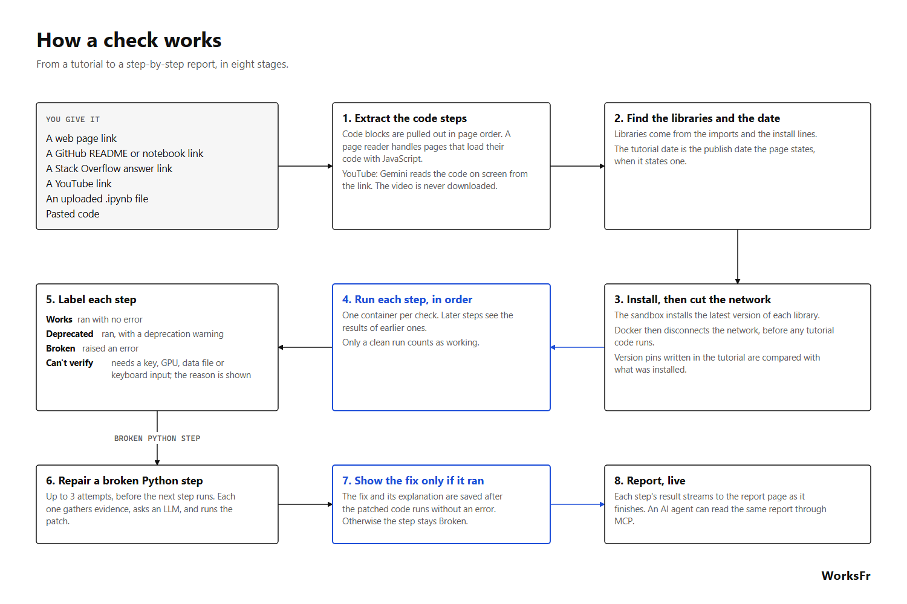
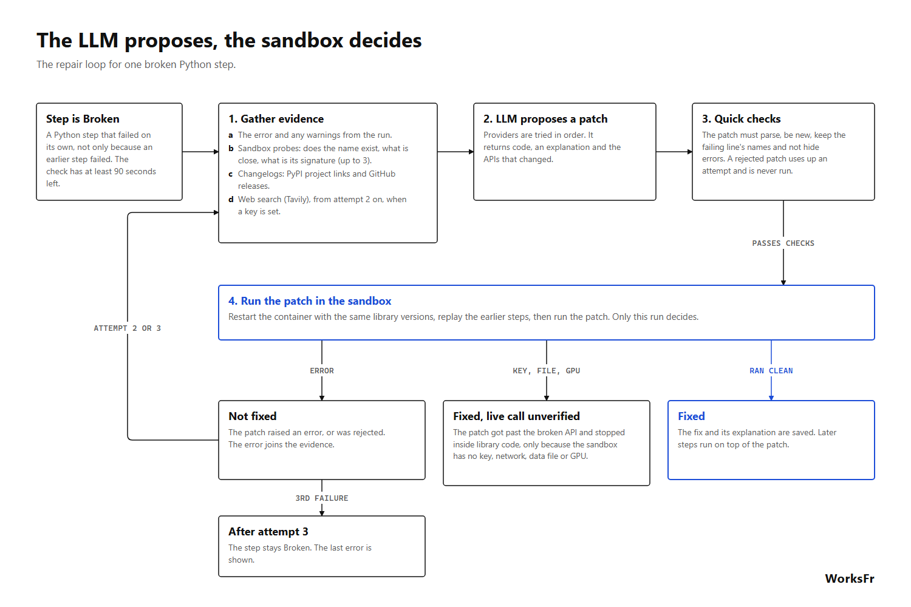
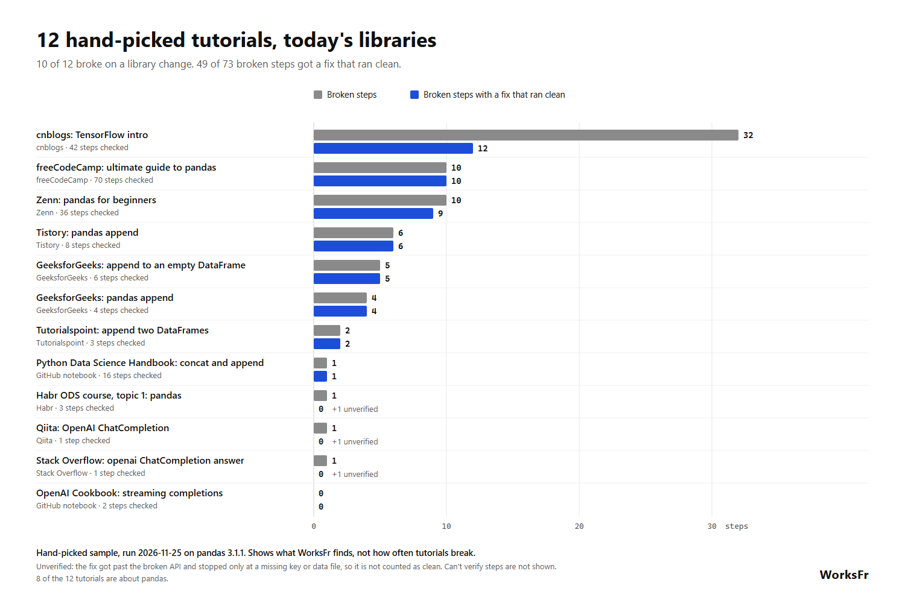
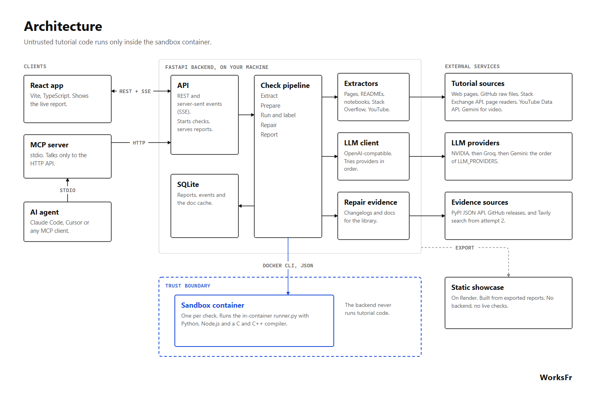
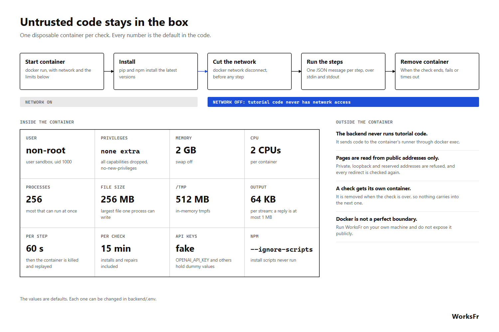

<div align="center">


# WorksFr

**Know your tutorial broke before your students do.**

[](LICENSE)




[Live showcase](https://worksfr-showcase.onrender.com) (read-only saved reports)

</div>

WorksFr runs every code step of a coding tutorial in a Docker sandbox against today's library versions and labels each step Works, Deprecated, Broken or Can't verify. When a Python step is broken, it works out what changed in the library, writes a replacement, and shows it only after the replacement has run without an error. Python, JavaScript, TypeScript, C and C++ steps run in the sandbox. Repair is Python only.

The showcase has saved reports from real checks. Live checks run on your own machine; see [Quickstart](#quickstart).

## How it works



1. You give WorksFr a tutorial: a link (web page, GitHub README, notebook link, Stack Overflow answer or YouTube video), an uploaded `.ipynb` file, or pasted code.
2. It pulls out the code blocks in order, works out which libraries they use, and reads the publish date the page states, when it states one.
3. It runs the blocks one at a time in a Docker sandbox with the latest version of each library installed, and gives each step a label.
4. For a broken Python step, the repair loop collects evidence about what changed, asks an LLM for a replacement, and runs it. It stops after three tries.
5. The report lists steps as facts: how many checkable steps still run, how many steps have each label, and how many replacements ran. Each changed step has a short note on what changed. There is no grade, and no fixed copy of the tutorial to download.

The LLM proposes and the sandbox decides. A replacement is saved only after it has run without an error. Note that "ran clean" means no error. I don't compare its output with the tutorial's.



### Step labels

| Label | Meaning |
| --- | --- |
| Works | Ran with no error and no deprecation warning. |
| Deprecated | Ran, but the library raised a `DeprecationWarning` or `FutureWarning`. |
| Broken | Raised an error. If the repair loop finds a replacement that runs, the step also shows "fixed" and how many tries it took. |
| Can't verify | Needs something the sandbox doesn't have, such as a real API key, a GPU, a large download, or keyboard input. The step shows the reason. |

A broken JavaScript, TypeScript, C or C++ step keeps its Broken label with the error, and no replacement is tried. Java, Rust and SQL are not supported.

## Case studies

I checked 12 hand-picked tutorials from 10 sources, written in 5 languages (English, Russian, Japanese, Chinese and Korean), against today's libraries. 10 of the 12 broke because an API they teach was removed. 73 steps broke, and 49 of them got a replacement that ran clean. The tutorials were hand-picked, so this shows what WorksFr finds, not how often tutorials break.



Two more tests:

- The AI-snippet test. An AI model wrote 20 snippets about changed APIs. 4 used code that is gone. 3 of those errored, and all 3 got a fix that ran. The fourth silently skipped the task and still ran.
- The agent run. In one run, Claude Code with one setup line checked a tutorial snippet through WorksFr's MCP server, tried two fixes of its own, and handed over only code that ran.

Each case-study row opens its saved report: [worksfr-showcase.onrender.com/#case-studies](https://worksfr-showcase.onrender.com/#case-studies).

## Quickstart

You need Docker Desktop running, Python 3.12 or newer, Node.js, and an API key for one LLM provider (see [Installation](#installation)).

```powershell
git clone https://github.com/tropicalbee/WorksFr.git
cd WorksFr
docker build -t worksfr-sandbox sandbox/
cd backend
python -m venv .venv
.venv\Scripts\Activate.ps1
pip install -r requirements.txt
Copy-Item .env.example .env
```

Put a provider key and model name in `backend/.env`, then start the backend:

```powershell
uvicorn app.main:app --reload
```

In a second terminal:

```powershell
cd frontend
npm install
npm run dev
```

Open http://localhost:5173, paste a tutorial link, and run a check.

## Installation

### Requirements

- Docker Desktop, running
- Python 3.12 or newer
- Node.js `^20.19.0` or `>=22.12.0` (Vite 8 needs this)
- An API key and a model name for at least one LLM provider: NVIDIA (build.nvidia.com), Groq or Google Gemini. Providers are set in `backend/.env` and tried in the order of `LLM_PROVIDERS`.

### Steps

Build the sandbox image. The first build takes several minutes and the image is large.

```powershell
docker build -t worksfr-sandbox sandbox/
```

Start the backend:

```powershell
cd backend
python -m venv .venv
.venv\Scripts\Activate.ps1
pip install -r requirements.txt
Copy-Item .env.example .env
uvicorn app.main:app --reload
```

Start the frontend in a second terminal:

```powershell
cd frontend
npm install
npm run dev
```

Open http://localhost:5173.

## Configuration

Fill in your API keys and model names in `backend/.env` before you run a check. `.env.example` lists every setting with its default. Model names have no default: copy a model id from the provider's model list (build.nvidia.com, console.groq.com/docs/models or ai.google.dev/gemini-api/docs/models) into `LLM_<NAME>_MODEL`. A provider with no key or no model is skipped, and the backend log says so at startup.

These keys are optional:

| Key | What it adds |
| --- | --- |
| `TAVILY_API_KEY` | Web search of a library's official docs on the second and third repair attempts. Without it, repairs use only the error, sandbox probes, PyPI and GitHub. |
| `FIRECRAWL_API_KEY`, `JINA_API_KEY` | A page reader for tutorial pages whose code is loaded by JavaScript. Jina Reader also works without a key. |
| `VIDEO_READER_API_KEY`, `VIDEO_READER_MODEL` | Reading YouTube tutorials. |
| `YOUTUBE_API_KEY` | Code links from a video's description and the author's comments. |

### YouTube tutorials

Paste a YouTube link and WorksFr reads the code that appears on screen. Gemini reads the public video straight from the link, and WorksFr never downloads the video. These settings go in `backend/.env`:

| Setting | Meaning |
| --- | --- |
| `VIDEO_READER_API_KEY` | A Gemini API key. It can be the same key as `LLM_GEMINI_API_KEY`. |
| `VIDEO_READER_MODEL` | One Gemini model, or a comma-separated list in fallback order, for example `gemini-3.6-flash,gemini-3.1-flash-lite`. When a model is out of quota or overloaded, WorksFr moves to the next one. If every model fails, the check says the problem is on Google's side. |
| `VIDEO_READS` | How many times each 5-minute chunk is read. The default is 2. Set 1 to halve the number of calls. |

Code read off a screen can be wrong, so every video step is marked "may have been misread" and carries a timestamp link to that moment in the video. A 15-minute video took about 15 minutes to check.

### Tech stack

| Part | Tools |
| --- | --- |
| Frontend | React, TypeScript, Vite, Tailwind CSS |
| Backend | FastAPI (Python) |
| Extraction | trafilatura and BeautifulSoup for web pages, nbformat for notebooks, Gemini for videos |
| Sandbox | Docker, one image with the Python, Node.js and C/C++ toolchains |
| LLM | Any OpenAI-compatible API. NVIDIA, Groq and Gemini are set up as providers. |
| Doc lookup | PyPI JSON API, GitHub releases, Tavily search |
| Storage | SQLite |

## Use WorksFr from an AI agent (MCP)

WorksFr ships an MCP server, so Claude Code, Claude Desktop, Cursor or any other MCP client can check a tutorial and read back the fixes that ran. The server only talks to the backend's HTTP API. The sandbox stays in the backend, and the MCP process never runs tutorial code. Start the backend first (`uvicorn app.main:app`). If it isn't on `http://127.0.0.1:8000`, set `WORKSFR_API_URL`.

Add it to Claude Code. Run this from the project root, and use your own path:

```powershell
claude mcp add worksfr -- C:\path\to\WorksFr\backend\.venv\Scripts\python.exe -m app.mcp_server
```

The server has to start with `backend/` as its working directory so that `app` imports. If your client doesn't let you set one, use `claude mcp add worksfr --env PYTHONPATH=C:\path\to\WorksFr\backend -- ...` or the `cwd` field below.

For Claude Desktop and Cursor, add this to the client's MCP config:

```json
{
  "mcpServers": {
    "worksfr": {
      "command": "C:\\path\\to\\WorksFr\\backend\\.venv\\Scripts\\python.exe",
      "args": ["-m", "app.mcp_server"],
      "cwd": "C:\\path\\to\\WorksFr\\backend"
    }
  }
}
```

Tools: `check_tutorial`, `check_code`, `get_report` and `recent_checks`. Try asking: "Check whether https://www.geeksforgeeks.org/python-pandas-dataframe-append/ still works." A check takes minutes.

## Architecture



The full design, from the check pipeline to the repair loop and the key decisions, is in [ARCHITECTURE.md](ARCHITECTURE.md).

```
backend/    FastAPI app: extraction, sandbox control, repair loop, API
frontend/   React + TypeScript web app
sandbox/    Dockerfile and the in-container runner
assets/     README screenshots and diagrams
```

## Security

Tutorial code is untrusted. It runs only inside the sandbox container, never in the backend process or on your host.



- The code runs as a non-root user, and the network is cut before any step runs.
- Each container gets 2 GB of memory, 2 CPUs and 256 processes.
- Files are capped at 256 MB and `/tmp` at 512 MB (`SANDBOX_FILE_SIZE_MB`, `SANDBOX_TMPFS_MB`).
- A step times out after 60 seconds, and a whole check after 15 minutes (`CHECK_TIMEOUT_SECONDS`, default 900).

Docker is not a perfect security boundary. Run WorksFr on your own machine and don't expose it publicly.

## Run the tests

From `backend/`, with the virtual environment active:

```powershell
pip install -r requirements-dev.txt
pytest -m "not docker and not llm"
ruff check .
```

`pytest -m docker` runs the sandbox tests. It needs the `worksfr-sandbox` image built first.

From `frontend/`:

```powershell
npm run build
npm run lint
npm run test
```

## Limitations

- Messy pages sometimes extract badly, for example when output and code share one block or when `>>>` prompts are mixed in.
- Steps that need a real API key, a GPU or a large download are marked "Can't verify". For SDKs like OpenAI's, WorksFr runs the code with a fake key. If the code gets as far as an authentication error, the imports and call signatures still work, and the step says so.
- Only Python steps are repaired. JavaScript, TypeScript, C and C++ steps are run and labeled, and nothing more.
- The tutorial's date comes only from the publish date the page states. A page without one shows no date.
- The repair loop patches one step at a time. Fixes that need changes across several steps may fail.
- Video checks depend on Gemini. Free-tier quotas run out (429) and the model is sometimes overloaded (503). The check then stops with a clear message. A misread video step can show as Broken.
- Video checks are titled "Untitled tutorial", because WorksFr doesn't fetch the video title.
- A package whose download is bigger than the sandbox's `/tmp` cap, such as PyTorch, doesn't install, and its steps are marked "Can't verify". TensorFlow and Keras are already in the image.
- One check runs at a time by default (`MAX_CONCURRENT_CHECKS`).
- Pages whose code is loaded by JavaScript need a page reader (a Firecrawl key, or Jina). Pages that refuse WorksFr or ask for a login are not read.

## Related work

- UpgrAIder (GitHub Next, archived) updated deprecated library calls in code using release notes.
- [Context7](https://github.com/upstash/context7) serves version-specific library docs to LLMs.
- [ABP TutorialValidator](https://abp.io/community/articles/automatically-validate-your-documentation-how-we-built-a-tutorial-validator-m3ozgkhv) runs the ABP framework's own tutorials to catch broken steps.
- Linters and coding agents flag or upgrade deprecated calls in your own project.

WorksFr works on someone else's tutorial, before you write any code. It takes any tutorial link, runs it, and repairs the broken Python steps.

## Built with

Built with AI coding assistants. The idea, the research into what already exists, the feature plan and the product decisions were mine, and I fixed parts of the code myself. Claude Code was my sounding board, planner and reviewer. Codex wrote most of the implementation from briefs. Nothing merged until the tests and the running app passed.

## License

Apache License 2.0. See [LICENSE](LICENSE) and [NOTICE](NOTICE). If you redistribute WorksFr or build on it, keep the NOTICE file.

---

<div align="center">

If it works fr for you, drop a star. Fork it, break it, make it better.<br>
Got an idea? Open a PR, no cap.

**Author:** [tropicalbee](https://github.com/tropicalbee)

</div>

> Built mostly after midnight, with Claude and Codex keeping me company. Neither of them ever asked for a coffee break, and both of them needed tests to prove they were right.
