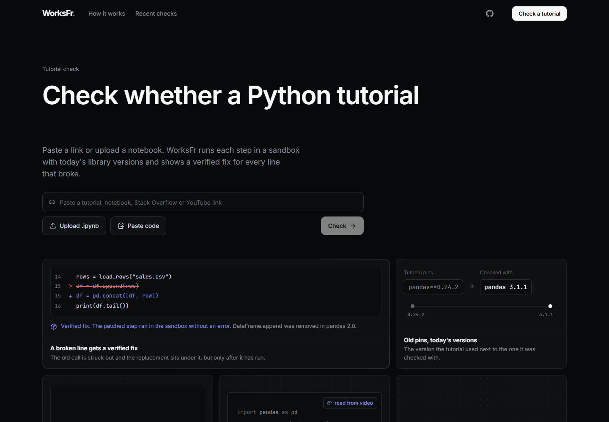
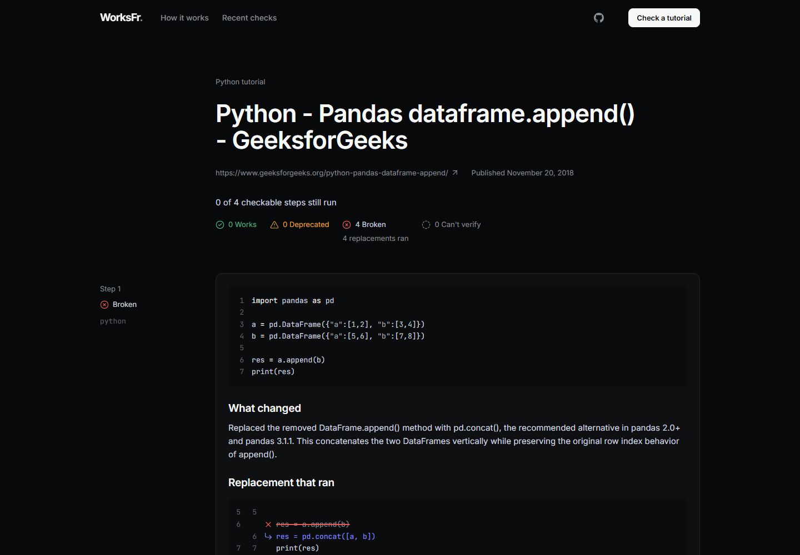

# WorksFr

WorksFr checks whether a coding tutorial still works with today's library versions. It runs every code step in a Docker sandbox and labels it. When a Python step is broken, WorksFr finds out what changed in the library, writes a replacement, and shows it only after the replacement has run without an error.





## How it works

1. You give WorksFr a tutorial. The home page takes a link (web page, GitHub README, notebook link, Stack Overflow answer or YouTube video), an uploaded `.ipynb` file, or pasted code.
2. WorksFr pulls out the code blocks in order, works out which libraries they use, and estimates when the tutorial was written.
3. It runs the blocks one at a time in a Docker sandbox with the latest version of each library installed.
4. Each step gets a label (see below).
5. For a broken Python step, the repair loop collects evidence about what changed, asks an LLM for a replacement, and runs it. It stops after three tries.
6. The report lists the steps as facts: how many of the checkable steps still run, how many steps have each label, and how many replacements ran. Each changed step has a short note on what changed in the library. The report has no grade or verdict, and WorksFr doesn't offer a fixed copy of the tutorial to download.

The LLM never decides that a step works. Only a successful run in the sandbox does.

## Languages

Steps in Python, JavaScript, TypeScript, C and C++ run in the sandbox. Java, Rust and SQL are not supported.

The repair loop is Python only. A broken JavaScript, TypeScript, C or C++ step keeps its Broken label with the error, and no replacement is tried.

## Step labels

| Label | Meaning |
| --- | --- |
| Works | Ran with no error and no deprecation warning. |
| Deprecated | Ran, but the library raised a `DeprecationWarning` or `FutureWarning`. |
| Broken | Raised an error. If the repair loop finds a replacement that runs, the step also shows "fixed" and how many tries it took. |
| Can't verify | Needs something the sandbox doesn't have, such as a real API key, a GPU, a large download, or keyboard input. The step shows the reason. |

## Video tutorials

Paste a YouTube link and WorksFr reads the code that appears on screen. Gemini reads the public video straight from the link. WorksFr never downloads the video.

Reading videos needs these settings in `backend/.env`:

| Setting | Meaning |
| --- | --- |
| `VIDEO_READER_API_KEY` | A Gemini API key. It can be the same key as `LLM_GEMINI_API_KEY`. |
| `VIDEO_READER_MODEL` | One Gemini model, or a comma-separated list in fallback order, for example `gemini-3.6-flash,gemini-3.1-flash-lite`. When a model is out of quota or overloaded, WorksFr moves to the next one. If every model fails, the check says the problem is on Google's side. |
| `VIDEO_READS` | How many times each 5-minute chunk is read. The default is 2. Set 1 to halve the number of calls. |

Code read off a screen can be wrong, so the backend marks every video step as low confidence ("may have been misread"). The web page doesn't show that mark or a timestamp link yet. A 15-minute video took about 15 minutes to check.

## Tech stack

| Part | Tools |
| --- | --- |
| Frontend | React, TypeScript, Vite, Tailwind CSS |
| Backend | FastAPI (Python) |
| Extraction | trafilatura and BeautifulSoup for web pages, nbformat for notebooks, Gemini for videos |
| Sandbox | Docker, one image with the Python, Node.js and C/C++ toolchains |
| LLM | Any OpenAI-compatible API. NVIDIA, Groq and Gemini are set up as providers. |
| Doc lookup | PyPI JSON API, GitHub releases, Tavily search |
| Storage | SQLite |

## Requirements

- Docker Desktop, running
- Python 3.12 or newer
- Node.js `^20.19.0` or `>=22.12.0` (Vite 8 needs this)
- An API key and a model name for at least one LLM provider: NVIDIA (build.nvidia.com), Groq or Google Gemini. Providers are set in `backend/.env` and tried in the order of `LLM_PROVIDERS`.

These are optional:

| Key | What it adds |
| --- | --- |
| `TAVILY_API_KEY` | Web search of a library's official docs on the second and third repair attempts. Without it, repairs use only the error, sandbox probes, PyPI and GitHub. |
| `FIRECRAWL_API_KEY`, `JINA_API_KEY` | A page reader for tutorial pages whose code is loaded by JavaScript. Jina Reader also works without a key. |
| `VIDEO_READER_API_KEY`, `VIDEO_READER_MODEL` | Reading YouTube tutorials. |
| `YOUTUBE_API_KEY` | Code links from a video's description and the author's comments. |

## Setup

Build the sandbox image. The first build takes several minutes and the image is large.

```powershell
docker build -t worksfr-sandbox sandbox/
```

Start the backend:

```powershell
cd backend
python -m venv .venv
.venv\Scripts\Activate.ps1
pip install -r requirements.txt
Copy-Item .env.example .env
uvicorn app.main:app --reload
```

Fill in your API keys and model names in `backend/.env` before you run a check. `.env.example` lists every setting with its default. Model names have no default: copy a model id from the provider's model list (build.nvidia.com, console.groq.com/docs/models or ai.google.dev/gemini-api/docs/models) into `LLM_<NAME>_MODEL`. A provider with no key or no model is skipped, and the backend log says so at startup.

Start the frontend in a second terminal:

```powershell
cd frontend
npm install
npm run dev
```

Open http://localhost:5173.

## Run the tests

From `backend/`, with the virtual environment active:

```powershell
pip install -r requirements-dev.txt
pytest -m "not docker and not llm"
ruff check .
```

`pytest -m docker` runs the sandbox tests. It needs the `worksfr-sandbox` image built first.

From `frontend/`:

```powershell
npm run build
npm run lint
```

## Use WorksFr from an agent (MCP)

WorksFr ships an MCP server, so Claude Code, Claude Desktop, Cursor or any other MCP client can check a tutorial and read back the verified fixes. The server only talks to the backend's HTTP API. The sandbox stays in the backend, and the MCP process never runs tutorial code. Start the backend first (`uvicorn app.main:app`). If it isn't on `http://127.0.0.1:8000`, set `WORKSFR_API_URL`.

Add it to Claude Code. Run this from the project root, and use your own path:

```powershell
claude mcp add worksfr -- C:\path\to\WorksFr\backend\.venv\Scripts\python.exe -m app.mcp_server
```

The server has to start with `backend/` as its working directory so that `app` imports. If your client doesn't let you set one, use `claude mcp add worksfr --env PYTHONPATH=C:\path\to\WorksFr\backend -- ...` or the `cwd` field below.

For Claude Desktop and Cursor, add this to the client's MCP config:

```json
{
  "mcpServers": {
    "worksfr": {
      "command": "C:\\path\\to\\WorksFr\\backend\\.venv\\Scripts\\python.exe",
      "args": ["-m", "app.mcp_server"],
      "cwd": "C:\\path\\to\\WorksFr\\backend"
    }
  }
}
```

Tools: `check_tutorial`, `check_code`, `get_report` and `recent_checks`. Try asking: "Check whether https://www.geeksforgeeks.org/python-pandas-dataframe-append/ still works." A check takes minutes.

## Project layout

```
backend/    FastAPI app: extraction, sandbox control, repair loop, API
frontend/   React + TypeScript web app
sandbox/    Dockerfile and the in-container runner
assets/     README screenshots
```

## Limitations

- WorksFr runs code from the internet. The sandbox limits memory, CPU, processes and network, but Docker is not a perfect security boundary. Run WorksFr on your own machine and don't expose it publicly.
- Messy pages sometimes extract badly, for example when output and code share one block or when `>>>` prompts are mixed in.
- Steps that need a real API key, a GPU or a large download are marked "Can't verify". For SDKs like OpenAI's, WorksFr runs the code with a fake key. If the code gets as far as an authentication error, the imports and call signatures still work, and the step says so.
- Only Python steps are repaired. JavaScript, TypeScript, C and C++ steps are run and labeled, and nothing more.
- The tutorial's age is an estimate based on page metadata and the code style.
- The repair loop patches one step at a time. Fixes that need changes across several steps may fail.
- Video checks depend on Gemini. Free-tier quotas run out (429) and the model is sometimes overloaded (503). The check then stops with a clear message. A misread video step can show as Broken.
- Video checks are titled "Untitled tutorial", because WorksFr doesn't fetch the video title.
- The sandbox caps each file at 256 MB and `/tmp` at 512 MB (`SANDBOX_FILE_SIZE_MB`, `SANDBOX_TMPFS_MB`). A package whose download is bigger than that, such as PyTorch, doesn't install, and its steps are marked "Can't verify". TensorFlow and Keras are already in the image.
- One check runs at a time by default (`MAX_CONCURRENT_CHECKS`). A check stops after 15 minutes (`CHECK_TIMEOUT_SECONDS`, default 900).
- Pages whose code is loaded by JavaScript need a page reader (a Firecrawl key, or Jina). Pages that refuse WorksFr or ask for a login are not read.

## Related work

- UpgrAIder (GitHub Next, archived) updated deprecated library calls in code using release notes.
- [Context7](https://github.com/upstash/context7) serves version-specific library docs to LLMs.
- [ABP TutorialValidator](https://abp.io/community/articles/automatically-validate-your-documentation-how-we-built-a-tutorial-validator-m3ozgkhv) runs the ABP framework's own tutorials to catch broken steps.
- Linters and coding agents flag or upgrade deprecated calls in your own project.

WorksFr works on someone else's tutorial, before you write any code. It takes any tutorial link, runs it, and repairs the broken Python steps.
